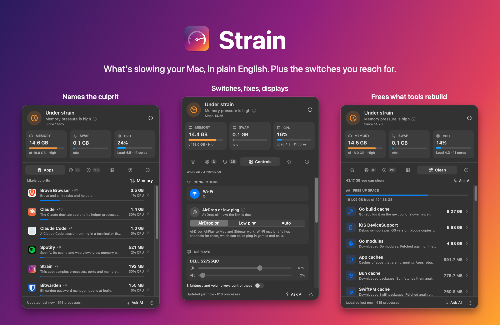

<p align="center">
  
</p>

<h1 align="center">Strain</h1>

<p align="center"><b>What's slowing your Mac, in plain English.</b><br>
A menu bar app that names the app behind the slowdown, frees the space your tools rebuild, and puts the switches you reach for (Wi-Fi, AirDrop, display brightness and volume) one click away.</p>

<p align="center">
  
  
  
  
  
</p>

<p align="center"></p>

## Why

600 processes don't tell you why the Mac is slow. Strain says it in one line: "Memory pressure is high. Top culprit: Xcode, 9 GB." It never acts without a click.

## What it does

| Tab | Shows | You can |
|---|---|---|
| **Apps** | Processes grouped by app, ranked by what's straining the Mac (memory or CPU), each explained | Quit or shut down, after a confirm |
| **Servers** | Every TCP listener: project, ports, local or open to your network | Open `localhost:<port>`, stop it |
| **Background** | Login items and launch agents, which run, which run as root | Jump to System Settings |
| **Controls** | Keep the Mac awake, Wi-Fi, Bluetooth, AirDrop vs low ping, brightness and speaker volume per display, one-click macOS fixes | Keep a long build running, restart Dock, flush DNS, drive an external monitor's brightness and volume from your keyboard |
| **Clean** | Space tools rebuild on their own: dev caches, stale `node_modules`/`target`, simulator data | Delete with a confirm |
| **Unknown** | Processes Strain can't explain yet | Ask AI to write the explanations |

The three meters open into detail views: memory breakdown, per-core load (Performance vs Efficiency), swap activity and 10 minutes of history.

### External displays

Brightness and volume go to the monitor itself over DDC/CI (Apple silicon, no driver). Turn on **Brightness and volume keys control these** in Controls and allow Accessibility once: the keys then drive the monitor under the pointer, and F14/F15 work as brightness keys. The built-in screen and speakers with their own volume stay with macOS.

## Levels

| Level | Means |
|---|---|
| 🟢 All good | Nothing is straining the Mac |
| 🟠 Under strain | High pressure, steady swapping, a hog for 30+ min, or low disk |
| 🔴 Struggling | Critical pressure, heavy swapping or a nearly full disk; notifies once per culprit |

Thresholds live in one place: [`Thresholds`](Sources/Strain/Pressure.swift).

## Install

```bash
brew install --cask josephgoksu/tap/strain
```

Or grab it from the [Strain page](https://josephgoksu.com/projects/strain), or download `Strain.zip` from [Releases](https://github.com/josephgoksu/strain/releases) (check it against `Strain.zip.sha256`), unzip, move `Strain.app` to Applications.

From source:

```bash
git clone https://github.com/josephgoksu/strain.git && cd strain
./build.sh install    # universal build → ~/Applications/Strain.app, launches it
```

Building needs Xcode's Swift 6 toolchain. `build.sh` signs with the Reaktif LLC Developer ID when it's in your keychain, ad-hoc otherwise (everything runs except the helper).

## Strain's helper (optional)

Admin tiles, holding AirDrop off for low ping, and reading Login Items need root. Turn on the helper once (Controls → **Turn on helper**, then allow it in System Settings → Login Items), and they stop asking for your password.

```
Strain.app ──XPC──► StrainHelper (root, launchd starts it on demand, exits after 30 s idle)
 checks: helper signed by our team      checks: caller is Strain signed by our team
                                        runs:   a fixed list of commands, by name only
```

Off, everything still works through macOS's password prompt.

## Privacy

| | |
|---|---|
| Network | None at runtime. No telemetry, no LLM calls, no update checks |
| Permissions | Accessibility only if you turn on display keys: Strain looks at brightness, volume and F14/F15 key codes and ignores every other key. Bluetooth only for its switch |
| Ports | Opens none |
| Data | Stays in `~/Library/Application Support/Strain` |
| Ask AI | Copies a prompt to your clipboard; you choose where to paste it |

## Check a Mac remotely

```bash
ssh <mac> ~/Applications/Strain.app/Contents/MacOS/Strain --report
```

Prints the running Strain's live status (level, culprits, meters, servers, disk). Works over Tailscale SSH; Strain itself stays offline.

## Develop

| | |
|---|---|
| Test | `swift test` |
| Screenshot | `Strain --snapshot out.png --tab=apps --meter=cpu --dark --fake-red` |
| Release | Add a CHANGELOG section, push tag `vX.Y.Z`: CI tests, builds, signs and notarizes (when the secrets are set), smoke-launches, publishes `Strain.zip` + sha256 and updates the Homebrew cask |
| Icon | `swift scripts/icon.swift` |
| README art | `swift scripts/readme-art.swift apps.png controls.png clean.png` (snapshots with `--dark`) |
| Spec | [`docs/specs/strain.md`](docs/specs/strain.md) |
| Learnings | [`context/`](context/) |
| Agent rules | [`AGENTS.md`](AGENTS.md) |

Explanations for processes live in [`Resources/explanations.json`](Resources/explanations.json); [`context/growing-explanations.md`](context/growing-explanations.md) says how to add more.

---

<p align="center"><sub>MIT © Joseph Goksu</sub></p>
